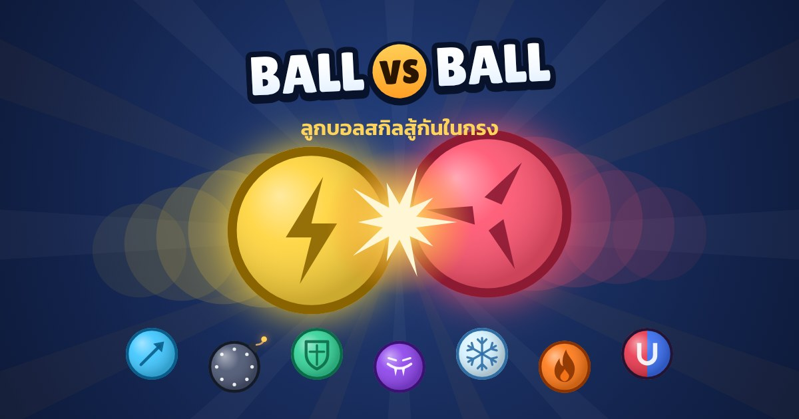

# Ball vs Ball

เกมลูกบอลสกิลสู้กันในกรง แบบ 2D ลูกบอลบังคับไม่ได้ เด้งเองตามฟิสิกส์ ใช้สกิลเองตามคูลดาวน์ ใคร HP หมดก่อนแพ้

**เล่นเลย:** https://xaisanatvtz25-ctrl.github.io/ball-vs-ball/

## มีอะไรบ้าง

- หน้าเมนูแยกเป็นหน้าๆ: หน้าแรก → เลือกนักสู้ → สู้ → ผลแพ้ชนะ, หน้าตัวละคร, หน้าตั้งค่า
- ตัวละครพิเศษ ໂຍສາຍຊອຍ ใช้หน้าจริงและเสียงจริงของเพื่อน มีหน้า 3 แบบ (ปกติ / โดนตี / อันติ) และเสียง 3 แบบ (เปิดตัว / โดนตี / อันติ)
- ต้องเลือกบอลครบ 2 ลูกก่อนถึงจะกดเริ่มเกมได้
- เสียงเอฟเฟกต์และเพลง (เปิดปิดได้ในหน้าตั้งค่า)
- นับถอยหลัง 3-2-1, สโลว์โมชันตอนน็อก, เกิน 45 วินาทีเข้าโหมดเดือด ดาเมจ x2, ครบ 90 วินาทีตัดสินด้วย HP
- เล่นออนไลน์: ใส่ชื่อ สร้างห้อง ได้รหัส 5 หลัก ให้เพื่อนกรอกรหัสเข้ามาเล่นด้วยกัน
- ติดตั้งเป็นแอปได้ (Chrome: เมนู ⋮ → ติดตั้งแอป) และเปิดเล่นแบบออฟไลน์ได้

## นักสู้ 10 ตัว

| ตัว | สกิล | คูลดาวน์ | ดาเมจ |
|---|---|---|---|
| ໂຍສາຍຊອຍ (ตัวละครพิเศษ) | พุ่งเกาะศัตรูแล้วแทงมีด 3 ครั้ง ระหว่างเกาะศัตรูใช้สกิลใหม่ไม่ได้ | 3.9 วิ | 4 x 3 |
| ARCHER ธนู | ยิงธนูตรงใส่ศัตรู | 1.5 วิ | 7 |
| BOMBER ระเบิด | โยนระเบิดวงกว้าง ดีดกระเด็นไกล | 3.0 วิ | 16 |
| BLADE ใบมีด | ใบมีดหมุนรอบตัว 3 วิ ปัดธนูได้ | 4.2 วิ | 6 / ครั้ง |
| VOLT สายฟ้า | พุ่งชนด้วยความเร็วสูง | 2.6 วิ | 12 |
| GUARD โล่ | กางโล่ 1.8 วิ กันทุกอย่าง สะท้อนกลับ | 4.5 วิ | 9 |
| VAMPIRE แวมไพร์ | ลำแสงดูดเลือด เติม HP ตัวเอง | 4.2 วิ | 10 + ฮีล 5 |
| FROST น้ำแข็ง | เกล็ดน้ำแข็ง 3 อัน ทำให้สกิลศัตรูช้าลง | 2.9 วิ | 5 x 3 |
| BLAZE ไฟ | ทิ้งรอยไฟ ศัตรูเหยียบแล้วติดไฟ | 5.5 วิ | 2 / ครั้ง |
| MAGNET แม่เหล็ก | ดูดศัตรูเข้าหา ชนแล้วช็อต | 3.6 วิ | 13 |

**ไฟอันติของ ໂຍສາຍຊອຍ:** แทงโดนหรือโดนตีจะชาร์จเกจไฟ เต็มแล้วจะเปิดพลังเปลวไฟ กางปีกยมทูต พุ่งเข้าไปแทง 5 ครั้งแล้วระเบิดเป็นพลุไฟ (4 x 5 + 12) ปกติได้ใช้ประมาณ 1 ครั้งต่อเกม

ค่าพลังปรับจากการจำลองแมตช์หลายพันรอบ ทุกตัวมีอัตราชนะรวมอยู่ราว 46–52% คูลดาวน์ทุกสกิลสุ่มเพิ่มลด 15% ทุกครั้ง (สุ่มจาก seed เดียวกันทั้งสองเครื่อง) เพื่อไม่ให้จังหวะสกิลวนซ้ำจนผลแพ้ชนะตายตัว

## เล่นออนไลน์ยังไง

1. กด **เล่นออนไลน์** แล้วใส่ชื่อ
2. คนหนึ่งกด **สร้างห้อง** แล้วส่งรหัส 5 หลักให้เพื่อน
3. เพื่อนกรอกรหัสแล้วกด **เข้าห้อง**
4. ทั้งสองคนเลือกบอลของตัวเอง แล้วกด **พร้อม** เกมจะเริ่มเอง

ระบบออนไลน์ส่งข้อความผ่านเซิร์ฟเวอร์ MQTT สาธารณะฟรี (HiveMQ และ EMQX ใช้พร้อมกัน 2 ที่ ถ้าที่หนึ่งล่มยังเล่นได้) ไม่ต้องมีเซิร์ฟเวอร์ของตัวเอง ใครรู้รหัสห้องก็เห็นชื่อในห้องได้ จึงไม่ควรใส่ข้อมูลส่วนตัวในชื่อ

## โครงสร้างโค้ด

- `js/sim.js` ระบบฟิสิกส์และสกิล เขียนแบบ deterministic (seed เดียวกัน ได้ผลเหมือนกันทุกเครื่อง) เครื่องของผู้เล่นทั้งสองจึงจำลองแมตช์เองได้ โดยเจ้าของห้องส่งสถานะมาเทียบทุก 2 วินาที
- `js/fighters.js` ชื่อ สี และคำอธิบายนักสู้
- `js/draw.js` วาดสนาม ลูกบอล เอฟเฟกต์ และภาพปก
- `js/audio.js` เสียงทั้งหมดสังเคราะห์ด้วย WebAudio ไม่มีไฟล์เสียง
- `js/mqtt-lite.js`, `js/net.js` ระบบห้องออนไลน์
- `js/main.js` หน้าเมนูและการควบคุมเกม
- `sw.js`, `manifest.webmanifest` ทำให้ติดตั้งเป็นแอปและเล่นออฟไลน์ได้

## เครดิต

ฟอนต์ [Kanit](https://fonts.google.com/specimen/Kanit), [Lilita One](https://fonts.google.com/specimen/Lilita+One) และ [Noto Sans Lao](https://fonts.google.com/noto/specimen/Noto+Sans+Lao) ใช้สัญญาอนุญาต SIL Open Font License (ไฟล์อยู่ในโฟลเดอร์ `fonts/`)

รูปหน้าและเสียงของ ໂຍສາຍຊອຍ เป็นของเจ้าของตัวจริง ใช้เฉพาะในเกมนี้
